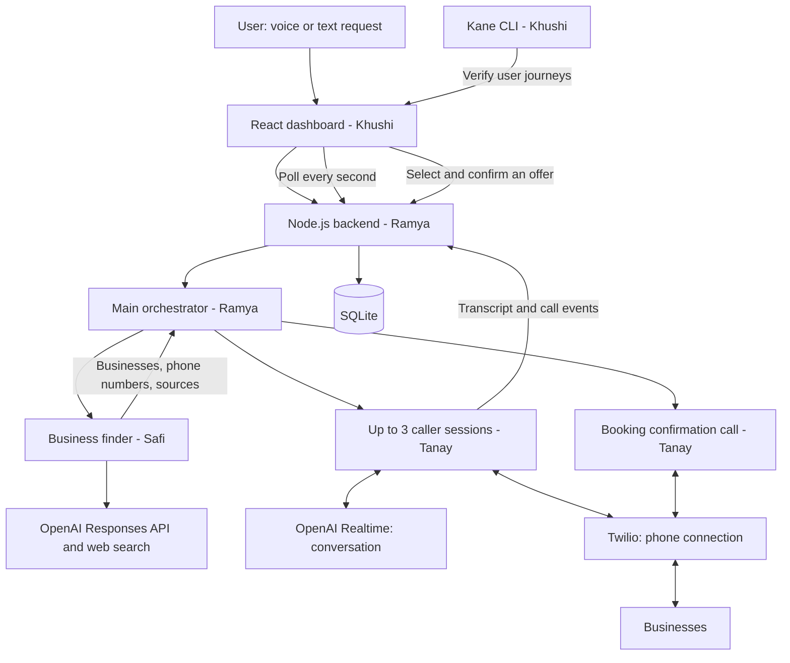

# Savior — Hackathon Architecture and Team Plan

Savior takes a consumer's voice request, finds relevant businesses, calls them concurrently to collect availability and quotes, and lets the user select an offer for a booking confirmation call.

**Demo scope:** mobile mechanics, one city, up to three businesses per task, one selected offer, and explicit business acceptance before showing a confirmed booking.

This repository starts with the agreed design. Components and interfaces below are implementation targets, not claims that the application is already built or tested.

## 1. Architecture



### Runtime choices

| Area | Choice | Owner |
|---|---|---|
| Frontend | React, Vite, TypeScript | Khushi |
| Backend | Node.js, Express, TypeScript | Ramya |
| Persistence | SQLite on the backend host | Ramya |
| Request understanding and summaries | OpenAI Responses API, Structured Outputs | Ramya |
| Discovery | OpenAI Responses API with web search | Safi |
| Phone conversations | OpenAI Realtime plus Twilio | Tanay |
| Dashboard updates | Poll task snapshot every second | Khushi + Ramya |
| Workflow verification | Kane CLI | Khushi |

One repository and one always-running backend process. That process serves the built frontend, handles HTTP and audio WebSockets, and runs background coordination. Use one backend instance with persistent storage. No Redis, separate job service, or vector database is needed for the demo.

SQLite is local to the running backend; developers use separate local files. A backend restart may interrupt calls. Persist interrupted tasks and mark them failed/interrupted on startup; do not automatically redial or book again.

## 2. Team ownership

### Tanay — voice agent and Twilio

Own everything between a structured call brief and the completed business conversation.

- Configure outbound calling, phone number, public webhook URLs, and Twilio audio streaming.
- Bridge each call's audio to its own OpenAI Realtime session.
- Configure caller instructions, input transcription, and assistant transcript events.
- Emit ordered transcript segments, lifecycle events, and the final structured result.
- Ask about service area, availability now, arrival estimate, price, additional fees, and quote conditions.
- Support two call purposes: `quote` and `booking`.
- For booking, read back the chosen offer and dispatch details and capture explicit acceptance or changed terms.
- Handle no answer, busy, voicemail, disconnect, and a bounded call duration.
- Verify provider webhook signatures and deduplicate provider events.

**Receives from Ramya:** task brief, business phone number, call ID, purpose, and selected offer for booking.

**Returns to Ramya:** transcript events, status, call outcome, structured quote or booking acceptance, and supporting transcript segment IDs.

**First milestone:** call a teammate's phone, have a real conversation, show its transcript, and return a structured quote. Prove this before parallel calls.

### Safi — business discovery

Own finding relevant businesses using location, service requirements, and the current time.

- Receive coordinates/address, service category, arrival constraint, and search time from the main agent.
- Resolve the location's IANA timezone; evaluate business hours in that timezone, rather than the server's timezone.
- Search for nearby mobile mechanics with OpenAI web search.
- Return up to three distinct businesses with published phone numbers and source URLs.
- Normalize phone numbers to international format when sufficient country context is known.
- Prefer businesses advertising mobile service and relevant operating hours.
- Record opening status as `open`, `closed`, or `unknown`, with its source and check time. Missing or ambiguous hours remain unknown.
- Explain why each result is relevant; deduplicate businesses sharing the same phone number.
- Never infer a guaranteed arrival time from distance, opening hours, or search results. Calls establish availability and ETA.

**Receives from Ramya:** validated task and discovery context.

**Returns to Ramya:** sourced business candidates and discovery warnings, including too few usable phone numbers or uncertain opening hours.

**First milestone:** return a structured, sourced shortlist for the agreed demo location. If live search fails, expose the failure; use clearly labeled seeded data only in demo/test mode.

### Ramya — main orchestrator and shared backend

Own the application workflow and the shared interfaces that connect all four workstreams.

- Build Express endpoints, SQLite persistence, task snapshots, and shared TypeScript types.
- Accept text or recorded audio; use OpenAI transcription for recorded requests.
- Use Responses API with Structured Outputs to extract the service, problem, location, vehicle details, arrival requirement, and optional budget.
- Return concise clarification prompts when essential information is missing.
- Invoke Safi's finder and pass its candidates to Tanay's caller module.
- Limit discovery to three candidates and calls to three concurrent quote sessions per task.
- Persist events, update task status, and expose offers as they arrive.
- Use backend validation for eligibility, selection, state transitions, and booking authorization.
- Generate a short user-facing summary after calls complete. Render routine progress from stored events.
- Atomically accept at most one booking attempt per task; deduplicate requests and webhooks.
- Add the simulated provider used by Khushi, with Tanay supplying its call-event shape.

**First milestone:** create a task, call a simulated finder and caller, persist results, and serve a complete dashboard snapshot.

### Khushi — dashboard and Kane CLI

Own the user experience and evidence that the integrated workflow works.

- Build voice recording and text entry, location entry/share, clarification UI, and task submission.
- Show task stage, candidate count, calls attempted/active/completed, and recent activity.
- Display separate business cards with call status and expanding speaker-labeled transcripts.
- Poll the task snapshot every second; preserve transcript ordering and avoid duplicate segments.
- Display price, currency, ETA, fees, availability, and unknown or conditional values clearly.
- Allow an eligible offer to be selected and explicitly confirmed; show pending, failed, changed terms, and accepted booking states.
- Turn agreed product requirements into Kane's requirement-linked generated tests using its assurance workflow.
- Run the saved Kane suite against test mode and retain evidence and coverage.
- Configure a required CI check and deployment dependency so an unsuccessful or incomplete Kane run blocks release.

**First milestone:** render an entire task using a fixture matching Ramya's shared types, including simultaneous call progress and offer selection.

## 3. End-to-end behavior

1. User records a request or types it and provides the breakdown location.
2. Main agent extracts a task and requests any essential missing details.
3. Finder receives location, current UTC time, local timezone, and service requirements.
4. Finder returns up to three candidates with sourced phone numbers.
5. Orchestrator starts independent quote calls, subject to the concurrency limit.
6. Caller events are persisted. The dashboard polls and displays ongoing transcripts and status.
7. Each completed call yields an offer, an unavailable result, or an explicit failure/unknown outcome.
8. User compares available offers and selects one. Initial availability does not reserve a mechanic.
9. Backend validates the selection and starts one booking confirmation call.
10. Business accepts the dispatch and terms, rejects it, or proposes changed terms. Changed terms require a new user decision; never silently accept a higher price.
11. Dashboard displays confirmed booking only when explicit business acceptance has been recorded.

Stop quote discovery after three businesses. Use configurable bounds such as 90 seconds per quote call and five minutes for the quote phase. Once the deadline passes, show completed results and mark remaining work timed out. Keep transport sessions and their events isolated by `taskId` and `callId`.

## 4. Shared contracts — agree on these first

The following are proposed TypeScript interfaces for implementation. Use ISO 8601 UTC timestamps, integer amounts in the currency's smallest unit, nullable unknown values, and stable IDs throughout.

```ts
type TaskStage =
  | 'needs_input' | 'finding' | 'calling' | 'offers_ready'
  | 'no_matches' | 'booking' | 'confirmed' | 'failed';

interface TaskBrief {
  taskId: string;
  service: 'mobile_mechanic';
  problem: string;
  location: {
    address: string;
    latitude: number | null;
    longitude: number | null;
    timezone: string; // IANA name for the breakdown location
  };
  vehicle: { make: string | null; model: string | null; year: number | null };
  maxArrivalMinutes: number;
  budgetMinor: number | null;
  currency: string | null;
}

interface DiscoveryRequest {
  task: TaskBrief;
  searchAt: string; // UTC timestamp supplied by backend
  limit: number; // 3 for demo
}

interface BusinessCandidate {
  businessId: string;
  name: string;
  phoneE164: string;
  address: string | null;
  sourceUrls: string[];
  openingStatus: 'open' | 'closed' | 'unknown';
  checkedAt: string;
  relevance: string;
}

interface Offer {
  offerId: string;
  taskId: string;
  businessId: string;
  callId: string;
  availableNow: boolean | null;
  etaMinutes: number | null;
  amountMinor: number | null;
  currency: string | null;
  quoteType: 'fixed' | 'estimate' | 'unknown';
  extraFees: string | null;
  conditions: string | null;
  evidenceSegmentIds: string[];
  capturedAt: string;
}

interface CallRequest {
  callId: string;
  task: TaskBrief;
  business: BusinessCandidate;
  purpose: 'quote' | 'booking';
  selectedOffer: Offer | null; // required by backend for booking
  dispatchContact: { name: string; phoneE164: string } | null;
}

type CallEvent =
  | { eventId: string; taskId: string; callId: string; at: string;
      type: 'status'; status: 'dialing' | 'connected' | 'completed' | 'failed';
      reason: string | null }
  | { eventId: string; taskId: string; callId: string; at: string;
      type: 'transcript'; sequence: number; segmentId: string;
      speaker: 'agent' | 'business'; text: string }
  | { eventId: string; taskId: string; callId: string; at: string;
      type: 'offer'; offer: Offer }
  | { eventId: string; taskId: string; callId: string; at: string;
      type: 'booking_result'; accepted: boolean;
      outcome: 'accepted' | 'declined' | 'terms_changed' | 'unknown';
      evidenceSegmentIds: string[]; summary: string };
```

Suggested module boundaries:

```ts
findBusinesses(request: DiscoveryRequest): Promise<{
  businesses: BusinessCandidate[];
  warnings: string[];
}>;

startCall(
  request: CallRequest,
  onEvent: (event: CallEvent) => Promise<void>
): Promise<void>; // resolves when the attempt terminates
```

The orchestrator supplies `onEvent`, validates the events, and persists them. Caller modules do not write directly into the database. Only the backend starts calls; the browser cannot invoke Twilio directly.

For the demo, show finalized transcript segments as soon as they arrive. Partial-word streaming is optional. Transcript order follows the session's ordered conversation items, not whichever transcription callback finishes first.

## 5. API and persistence

| Endpoint | Responsibility |
|---|---|
| `POST /api/transcriptions` | Recorded audio to text; server calls OpenAI |
| `POST /api/tasks` | Extract request; create task or return clarification |
| `POST /api/tasks/:id/answers` | Apply clarification answers and resume |
| `GET /api/tasks/:id` | Full dashboard snapshot: task, businesses, calls, transcript, offers, booking |
| `POST /api/tasks/:id/book` | Validate selected offer and dispatch contact; start booking once |
| `POST /api/telephony/status` | Receive verified Twilio status callbacks |
| `POST /api/telephony/voice` | Supply Twilio call instructions |
| `WS /api/telephony/media` | Bridge phone audio to the associated OpenAI session |

Use four tables: `tasks`, `calls`, `transcript_segments`, and `offers`. Store discovery candidates and activity/processed-event metadata as JSON on the task/call records for this demo. Store booking status and selected offer on `tasks`; booking calls are `calls` with purpose `booking`.

Ramya owns the snapshot format and schema migrations. Khushi and Tanay review the snapshot and event types before implementation. All team members keep credentials server-side and put local secrets in ignored environment files.

## 6. OpenAI usage

| Capability | OpenAI integration |
|---|---|
| Recorded user request | Audio transcription API |
| Intent and clarification | Responses API with Structured Outputs |
| Business search | Responses API with web search; retain source URLs |
| Business conversation | Realtime speech-to-speech session per call |
| Offer extraction | Validated call tool output, with Responses extraction from the transcript as needed |
| Final report | Responses API using stored structured results |

Configure model IDs through environment variables and verify project access during setup. OpenAI credits cover eligible OpenAI API usage; plan separately for phone-provider charges and hosting. The initial telephony design uses Twilio plus a server audio bridge, without requiring direct OpenAI outbound SIP access.

Structured schemas establish data shape, not factual correctness. Never invent a phone number, price, availability, or booking confirmation to satisfy a schema. Preserve nulls and source evidence.

## 7. Kane CLI integration — Khushi owns this

### Repeatable test mode

Use an `APP_MODE` configuration with `live` and `test` values. In test mode, discovery returns fixed businesses and the calling adapter emits controlled transcript, offer, and lifecycle events. All task logic, persistence, APIs, offer eligibility, and booking handling remain real. Test mode must never dial real numbers.

The UI should visibly label simulated data. Keep test controls unavailable in live mode. Use a separate test database and reset it between suite runs.

### Assurance and release workflow

1. Save the agreed product requirements as a requirements document.
2. Ingest them with Kane's assurance commands and generate requirement-linked runnable tests. Do not hand-author `_test.md` cases.
3. Review generated coverage and supply required variables, including the application URL.
4. Run the generated saved suite against the application in test mode.
5. Retain run evidence, acceptance-criteria coverage, and suite completion results as CI artifacts.
6. Make the Kane check required for merging and make deployment depend on its success. Configure these in GitHub; merely adding a workflow file does not enforce branch protection.

Coverage priorities are task clarification, location and arrival constraints, simultaneous call updates, transcript/business association, faithful quotes, unknown values, partial failures, offer selection, changed terms, and duplicate-booking prevention. These are requirements to feed Kane, not manually authored test cases.

Kane establishes application workflow behavior under controlled call responses. A separate live integration check using a team-controlled phone establishes actual audio, transcription, and webhook behavior. Keep these two kinds of evidence distinct.

## 8. Suggested repository layout

```text
README.md                     # This architecture and team plan
apps/
  web/                        # Khushi: React dashboard
  server/
    src/
      orchestrator/           # Ramya: extraction, coordination, summaries
      discovery/              # Safi: business finder
      voice/                  # Tanay: Twilio + OpenAI Realtime
      api/                    # Ramya: routes and snapshots
      db/                     # Ramya: schema and persistence
      testing/                # Ramya + Khushi: simulated providers
packages/
  shared/                     # Contracts agreed by all four
requirements/                 # Product requirements for Kane
tests/kane/                   # Kane-generated tests
.github/workflows/            # Khushi: Kane check and deployment gate
.env.example                  # Variable names only, no credentials
```

This is the intended layout, not an implemented scaffold. Keep model names, provider credentials, phone number, public base URL, database path, mode, call limit, and deadlines in environment configuration. Do not commit databases, recordings, real contact data, or credentials.

## 9. Integration order

| Milestone | Team activity | Done when |
|---|---|---|
| 1. Contracts | All four agree on types; Ramya owns shared package | Everyone can use the same task, candidate, event, and offer shapes |
| 2. Parallel foundations | Tanay proves a live call; Safi proves discovery; Ramya builds simulated workflow; Khushi builds fixture-based UI | Each component works independently |
| 3. First complete flow | Connect UI, orchestrator, discovery, and one real quote call | A voice/text request produces a sourced offer and transcript |
| 4. Concurrent calls and booking | Enable three sessions; connect selection to confirmation call | User can compare results and receive explicit acceptance |
| 5. Verification and demo | Khushi runs Kane; team checks real phone path | Passing workflow evidence and a rehearsed live demo |

Use team-controlled numbers for rehearsals. Keep a visibly labeled simulated mode available if live phone connectivity fails during the presentation.

## 10. Demo boundaries

- Support mobile mechanics in one agreed city and language.
- Start with direct-answer phone conversations; complex IVR navigation is out of scope.
- No payments, account system, map UI, production-scale scheduling, or automatic booking retries.
- Unknown ETA does not meet a 30-minute requirement. Offers outside the requirement remain clearly labeled and cannot be booked through the default flow.
- Use a fixed, configured decision window for offers; reconfirm availability and terms during booking.
- Initial calls identify the caller as an AI assistant collecting options. They do not authorize dispatch.
- A booking button click means a request is being confirmed, not that the business has accepted.

## References

- [OpenAI Structured Outputs](https://developers.openai.com/api/docs/guides/structured-outputs)
- [OpenAI web search](https://developers.openai.com/api/docs/guides/tools-web-search)
- [OpenAI recorded speech transcription](https://developers.openai.com/api/docs/guides/speech-to-text)
- [OpenAI Realtime conversations](https://developers.openai.com/api/docs/guides/realtime-conversations)

Kane integration follows the locally available Kane CLI skill and its assurance, saved-suite execution, evidence, and coverage workflows. Exact commands and account/project configuration should be verified when implementation begins.
