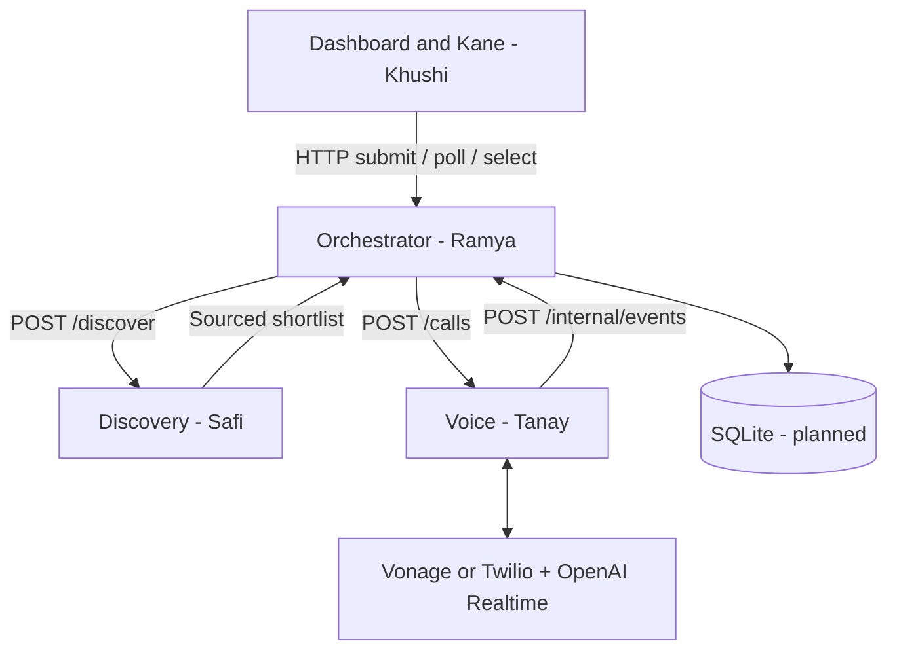

# Architecture and ownership

## Ramya: services/orchestrator
Own shared contracts, backend API, task extraction/clarifications using OpenAI Responses + Structured Outputs, coordination, summaries, SQLite persistence, and validation. The current store is memory only and is lost on restart. Replace it before real dispatch. Only orchestrator owns durable business state. Implement atomic booking requests, offer expiry, bounded tasks, restart handling, and durable callback deduplication. Current mode supports one in-process booking state transition and event-ID deduplication, not durable delivery.

## Safi: services/discovery
Implement OpenAI web search discovery using breakdown location, backend-supplied UTC time, and the location's IANA timezone. Return at most three deduplicated businesses, normalized published phone numbers, source URLs, opening status, and warnings. Missing hours remain unknown. Opening hours do not establish a 30-minute ETA. Current adapter returns fictional businesses only.

## Tanay: services/voice
Own Vonage/Twilio outbound calling and media WebSockets to OpenAI Realtime. Give each call an isolated context and task/call IDs. Emit finalized ordered speaker-labeled transcripts, call lifecycle, supported quotes, and explicit booking acceptance. Verify Twilio signatures, bound call duration, and handle voicemail/no answer/disconnect. Quote calls cannot dispatch. Booking calls must reconfirm selected terms and collect the user's dispatch contact first; changed terms return to the user. The voice worker now supports live quote calls via a provider-only tunnel, isolated Realtime sessions, signed callbacks, transcript-supported quote tools, local journaling, and callback retry/deduplication. Live booking remains blocked pending dispatch contacts and durable orchestrator state. Vonage supports an independent connection probe and PCM media adapter; Twilio uses PCMU. See services/voice/README.md for the stand-alone local rehearsal.

## Khushi: apps/dashboard and tests/kane
Own voice recording, text input, breakdown location, clarification UI, progress counts, transcripts, offer comparison and explicit selection. Browser timezone in the scaffold is only a placeholder: use the breakdown location's timezone in live discovery. Poll GET /api/tasks/:id every second. Implement Kane assurance ingestion/design, generated suites, evidence, and the required release gate. Test mode shares workflow code but replaces discovery/call adapters. No handwritten Kane cases. A team-phone live integration check is separate from deterministic browser evidence.

## Interfaces
All runtime request/event schemas live in packages/shared/src/index.ts. Internal discovery, voice and callback endpoints require INTERNAL_SERVICE_TOKEN. The browser only talks to orchestrator. Services use HTTP; voice acknowledges immediately and reports progress through callbacks. Bind locally during development and expose only the voice provider endpoints through a tunnel once implemented.

Current endpoints: POST /api/tasks, GET /api/tasks/:id, POST /api/tasks/:id/book (body offerId), POST /internal/events; POST /discover; POST /calls; GET /health on each service. APP_MODE=live returns 501 for unfinished discovery/orchestration. VOICE_MODE=live independently enables voice quote calls; missing setup returns 503 and live booking returns 409.

## Integration order
1. Agree on contracts; all four work in their owned directories.
2. Tanay proves one real call to a teammate; Safi proves sourced search; Ramya replaces memory store and adds OpenAI extraction; Khushi builds input/transcripts and generates Kane tests.
3. Connect a single complete quote flow, then three concurrent calls.
4. Collect dispatch contact, reconfirm terms and acceptance; protect against duplicate dispatch.
5. Run Kane verification and a separate live phone rehearsal. Configure the Kane check as required before deployment.

## API references
- https://developers.openai.com/api/docs/guides/structured-outputs
- https://developers.openai.com/api/docs/guides/tools-web-search
- https://developers.openai.com/api/docs/guides/realtime-conversations
- https://developers.openai.com/api/docs/guides/speech-to-text
